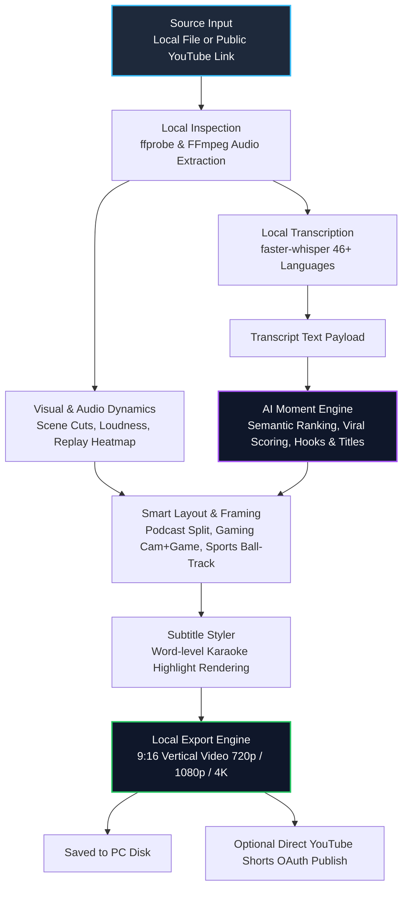

# 🌙 LunarClip

### **AI-Powered Long-to-Vertical Video Clipper for Windows**
*Turn hours of podcasts, gaming streams, and sports into viral 9:16 vertical shorts in minutes — 100% on your local PC.*

 

[**Explore LunarClip**](https://lunarclip.com) • [**Download Desktop App**](https://lunarclip.com/download) • [**Features & Highlights**](#-core-features) • [**Pipeline Architecture**](#-how-lunarclip-works-architecture) • [**FAQ**](#-frequently-asked-questions)

---

## 🚀 Overview

**[LunarClip](https://lunarclip.com)** is a native Windows desktop application and intelligent clipping engine designed for content creators, streamers, podcasters, and video editors. 

Creating vertical shorts (TikTok, YouTube Shorts, Instagram Reels) from long recordings typically requires either spending hours scrubbing manual timelines or uploading gigabytes of sensitive video files to expensive cloud clippers. 

**LunarClip redefines this workflow with a local-first architecture**:
- **Zero Heavy Uploads**: Your raw video frames and audio never leave your machine.
- **Multi-Modal AI Moment Selection**: Combines speech semantics, scene cuts, audio loudness spikes, and viewer replay curves to score the best candidate moments.
- **Smart Adaptive Reframing**: Dynamically crops 16:9 widescreen into vertical 9:16 with layout presets tuned specifically for podcasts, gaming, and sports.
- **Animated Subtitles**: Word-level animated captions powered by `faster-whisper` in 46+ languages.

👉 **Get started today at [lunarclip.com](https://lunarclip.com) or download directly from [lunarclip.com/download](https://lunarclip.com/download).**

---

## ✨ Core Features

### 🔒 1. Local-First Privacy & Zero Wait Times
- Unlike cloud-based video clippers that require uploading 10 GB - 50 GB video files before processing even begins, LunarClip operates directly on your local storage or public YouTube links.
- Media inspection (`ffprobe`), audio demuxing (`ffmpeg`), and local speech-to-text (`faster-whisper`) execute entirely on your Windows PC.
- Only lightweight transcript text is sent for AI semantic scoring, keeping bandwidth usage near zero and protecting raw source files.

### 🎯 2. Multi-Signal Highlight Scoring
LunarClip does not rely on text transcripts alone. It cross-references multiple independent signals to pick genuine highlights:
- **Viewer Heatmaps**: Detects high-replay spikes from YouTube sources.
- **Acoustic Energy**: Tracks voice inflections, audience laughter, and commentary volume surges.
- **Scene Dynamics**: Computes optical flow and camera cut frequencies to avoid stagnant segments.
- **AI Moment Explanations**: Every suggested clip comes with a viral score and an explicit written reason explaining why that specific segment was selected.
- **"Find Another Cut"**: Instant one-click alternative boundary generator for any picked moment.

### 📐 3. Intelligent Auto-Reframing Engine
Horizontal 16:9 crops often lose crucial visual subjects. LunarClip includes context-aware layout models:
- **🎙️ Podcast Mode**: Automatically identifies speakers, triggers split-screen layouts when two people converse, and performs cut-switching to whoever holds the floor.
- **🎮 Gaming Mode** *(Valorant, LoL, Minecraft, etc.)*: Automatically pins the facecam to the top (~30% of frame) and fits gameplay action in the lower 70%.
- **⚽ Sports Mode** *(Football, Basketball, etc.)*: Dynamic wide-tracking that follows the ball and nearby players without jarring punch-ins or clipped action.
- **Aspect Ratio Freedom**: Render in vertical `9:16` (Shorts / Reels / TikTok), `4:5` (Instagram Feed), `1:1` (Square), or `16:9` (Landscape).

### 💬 4. Word-by-Word Animated Subtitles
- Built-in caption templates with custom typography, shadow, outline, and highlight animations.
- Subtitles are rendered directly into the output video stream with pixel precision.
- Supports 46+ languages with automated language detection.

### ⚡ 5. Transparent, Predictable Plans (No Credit Traps)
No opaque "credits" that expire or penalize longer recordings.
- **Free Tier**: 5 videos per month (up to 2h source duration), 720p output with watermark.
- **Supporter Plan ($3,49/mo)**: 25 videos per month (up to 4h source duration), 1080p crisp output, watermark removed.
- **Pro Plan ($10/mo)**: 50 videos per month (up to 8h sources), up to 4K / 2160p output (matching 4K source files), up to 20 clips per video, and direct YouTube publishing integration.

---

## 🛠️ How LunarClip Works (Architecture)

---

## 📊 LunarClip vs. Cloud Clipping Services

| Feature | 🌙 LunarClip | Traditional Cloud Clippers (e.g. OpusClip, Vizard) |
| :--- | :--- | :--- |
| **Video Upload Needed** | ❌ **No** (Source video stays on your PC) | ⚠️ Yes (Must upload multi-GB source files) |
| **Privacy & Security** | 🔒 **Local-first**; frames and audio never leave PC | ☁️ Entire video uploaded to third-party cloud |
| **Long File Support** | ⏱️ Up to 8 hours per source file on Pro | ⏳ Heavily restricted or high credit cost |
| **Pricing Model** | 💳 Flat monthly source allowance ($0 / $3.49 / $7.99) | 🪙 Opaque credit balances that drain fast |
| **Layout Flexibility** | 🎨 Split-screen, Game facecam overlay, Sports wide track | 🔲 Fixed center crops or generic templates |
| **Subtitles** | 🔤 46+ languages with faster-whisper | 🌐 Variable cloud ASR |
| **Supported OS** | 🖥️ Native Windows 10 & 11 (64-bit) | 🌐 Web browser only |

---

## 🎮 Use Cases

- **Streamers (Twitch / YouTube)**: Turn 4-hour livestreams of Valorant, League of Legends, or Minecraft into engaging TikToks without scrubbing through the timeline.
- **Podcasters**: Automatically frame 2-person dialogues into dynamic split-screens or speaker-swapped vertical reels.
- **Sports Analysts & Highlights**: Auto-crop basketball and football games with intelligent ball-following framing.
- **Educators & Keynotes**: Extract high-retention quotes, insights, and presentation points with burned-in subtitles.

---

## 💻 System Requirements

- **Operating System**: Windows 10 or Windows 11 (64-bit)
- **Memory (RAM)**: 8 GB minimum (16 GB recommended for 4K / long files)
- **Disk Space**: 2 GB free space for runtime and processing cache
- **Internet Connection**: Required for semantic moment selection and authentication

---

## 🔗 Official Links & Resources

- 🌐 **Official Website**: [https://lunarclip.com](https://lunarclip.com)
- 📥 **Download for Windows**: [https://lunarclip.com/download](https://lunarclip.com/download)
- 💡 **Feature Guides**: [https://lunarclip.com](https://lunarclip.com)
- 🐞 **Issue Tracker**: [GitHub Issues](https://github.com/mert-alp/lunarclip/issues)
- 📜 **Terms & Privacy**: [Terms of Service](https://lunarclip.com) • [Privacy Policy](https://lunarclip.com)

---

## 📄 License

This repository and its documentation are open for the community under the [MIT License](LICENSE). LunarClip desktop software is distributed via [lunarclip.com](https://lunarclip.com).
