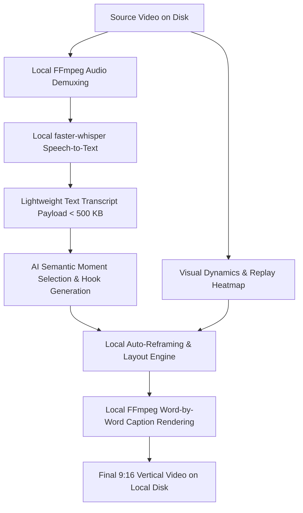

# Why We Built a Local-First AI Video Clipper for Windows (Instead of Another Cloud Wrapper)

Turning long-form videos—such as 2-hour podcast recordings, Twitch gaming VODs, or sports matches—into short, engaging vertical clips (TikTok, YouTube Shorts, Instagram Reels) has become a staple of modern content marketing.

Over the past few years, a wave of cloud-based AI clippers (like OpusClip, Vizard, and Klap) emerged to automate this process. But if you have ever tried editing a multi-hour recording using browser-based clippers, you have likely run into two massive architectural bottlenecks:

1. **The Upload Wall**: Uploading a 20GB–40GB 1080p/4K recording over typical broadband can take 45 minutes to an hour before processing even starts.
2. **The "Per-Minute Credit Burn"**: Cloud rendering is expensive, forcing platforms into restrictive per-minute credit quotas where a single 2-hour podcast burns 120 credits.

To solve this, we took a completely different architectural direction when building **[LunarClip](https://lunarclip.com)**: a native Windows desktop application built from the ground up on a **local-first processing engine**.

In this post, I want to break down how our local-first pipeline works, how we integrated `faster-whisper` and `FFmpeg` on Windows, and why decoupling heavy video processing from cloud servers produces a faster, more cost-effective clipping workflow.

---

## The Core Architecture: Keeping the Heavy Pixels Local

In traditional cloud clipping architectures, the client browser is merely a dumb uploader:

```
[User Browser] === (Heavy 20 GB Upload) ===> [Cloud GPU Cluster] ===> [AI Moment Detection & Render]
```

When processing high-bitrate video, transferring millions of frames over HTTP solely to analyze speech and motion is inherently inefficient.

With **[LunarClip](https://lunarclip.com)**, we inverted this flow:



### 1. High-Speed Local Demuxing with FFmpeg
Rather than uploading the video file, LunarClip inspects local media containers via `ffprobe` and extracts high-efficiency audio streams locally using custom `FFmpeg` pipelines. A 2-hour video's audio track is extracted in just **3 to 8 seconds** on modern NVMe drives.

### 2. Local Speech-to-Text with faster-whisper
Instead of incurring recurring cloud transcription API costs, we execute speech recognition directly on the user's Windows hardware using `faster-whisper` (backed by CTranslate2):
- Supports **46+ languages** with automatic language identification.
- Provides precise, word-level timestamps necessary for animated karaoke subtitles.
- Runs 4x faster than vanilla OpenAI Whisper while consuming minimal RAM.

### 3. Lightweight Payload to Cloud AI
The only data that ever leaves the user's machine is the **lightweight text transcript** (typically under 500 KB). 
Our backend semantic model analyzes the dialogue, identifies engaging narrative hooks, scores viral potential, and suggests optimal cut boundaries—without ever receiving a single pixel of your raw footage.

---

## Solving the Framing Dilemma: Context-Aware Layouts

A naive center-crop from 16:9 widescreen to 9:16 vertical discards approximately **66% of the original frame**. If an editor isn't careful, speakers drift out of bounds and gameplay HUDs get chopped in half.

To solve this, we developed specialized layout engines tailored to specific content archetypes:

### 🎙️ The Podcast Engine (Split-Screen & Speaker Tracking)
When two hosts or guests converse, a single vertical window cannot comfortably accommodate both participants simultaneously without zooming out excessively. 
Our layout engine detects face clusters, triggers a dynamic **split-screen layout**, and executes snappy jump-cuts to whichever speaker holds the floor.

### 🎮 The Gaming Engine (Facecam + Gameplay Stack)
For games like Valorant, League of Legends, and Minecraft, viewer retention relies on seeing both the creator's reaction and the in-game action:
- Automatically pins the facecam to the top ~30% of the vertical frame.
- Centers and scales the in-game action in the lower ~70%.

### ⚽ The Sports Engine (Ball & Player Tracking)
Fast-paced sports footage (basketball, football) frequently suffers when tight punch-in crops are applied. Our Sports framing mode maintains a wide tracking envelope that follows the ball and court action dynamically without jarring camera swings.

---

## Real World Results: Predictability Over Credit Traps

By eliminating heavy cloud GPU transcoding bills for every uploaded minute, we eliminated the concept of expiring credit tokens. 
Instead of worrying whether a 3-hour livestream will burn through an entire month's allowance, creators get flat, predictable monthly video allowances.

Key benefits observed during creator testing:
- **Zero upload waiting**: You open a 30 GB local recording and processing begins immediately.
- **Absolute privacy**: Sensitive unreleased footage, confidential interviews, and personal podcasts never sit on an unverified third-party cloud bucket.
- **Accurate subtitle rendering**: Burned-in, word-by-word animated captions are generated directly into the final stream with custom outline and drop-shadow styling.

---

## Try It Out

LunarClip is currently available as a native 64-bit desktop application for **Windows 10 and Windows 11**.

- 🌐 **Official Website**: [https://lunarclip.com](https://lunarclip.com)
- 📥 **Download Free Plan**: [https://lunarclip.com/download](https://lunarclip.com/download)
- 🛠️ **Public Showcase & Community**: [https://github.com/mert-alp/lunarclip](https://github.com/mert-alp/lunarclip)

I'd love to hear your thoughts on local-first desktop architectures: have you experimented with running Whisper models locally on consumer hardware, and what performance bottlenecks did you encounter?
